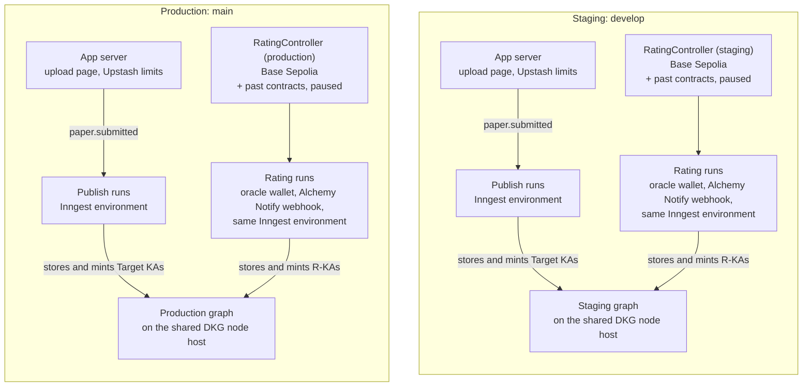
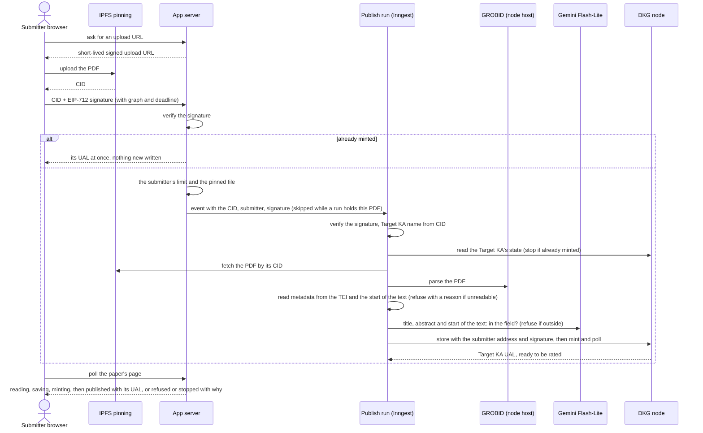
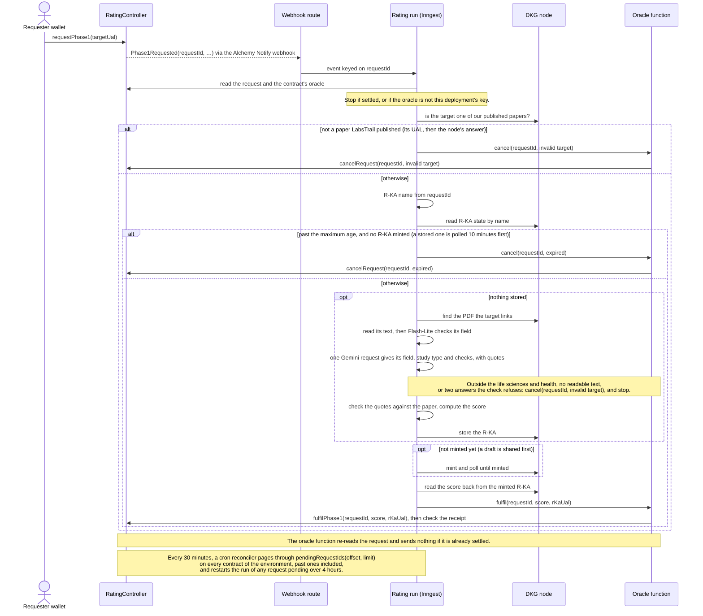

# LabsTrail

[](https://github.com/SiegfriedBz/labstrail/actions/workflows/ci.yml)

Open, traceable ratings for life-science papers.

LabsTrail publishes life-science and health papers and gives them an open quality rating
that anyone can request, read and verify
([ADR 0037](docs/adr/0037-labstrail-rates-life-science-and-health-papers.md)).

## Why

How much to trust a paper is usually inferred from where it was published, and
the reviews behind that judgement are rarely public. Yet many published results
cannot be repeated: in a 2016 Nature survey of more than 1,500 researchers, more
than 70% had tried and failed to reproduce another scientist's experiments
(Baker, *Nature* 533, 452–454). AI agents now read and build on papers at a scale
no person can, with no better way to tell which ones give enough to be repeated.
LabsTrail rates the quality of a paper in the open and attaches the rating to the
paper itself: each paper and each rating is a public record on the OriginTrail
Decentralized Knowledge Graph (DKG), anchored on chain, with the paper's PDF on
IPFS at an address hashed from its content, so none of them can be quietly
changed. A rating starts as a machine score of how completely the paper reports
what others need to reproduce its work, and grows through transparent human
review and, later, wet-lab replication
([ADR 0012](docs/adr/0012-three-phases-settled-by-the-oracle.md)).

Status: early. LabsTrail is a rebuild of an earlier prototype,
`desci-rating-dapp`, which ran both flows (publish a paper, rate it) end to end on
Base Sepolia. This repo starts again from clean foundations (monorepo, tooling,
CI), and its ADRs and domain facts record what the prototype taught us. The first
user-facing feature is the upload page: connect a wallet, publish a PDF, follow it until it
is minted, then verify its record (signature, token, UAL, CID) from the paper's page. Every
published paper is listed at `/papers`, newest first, read a page at a time from the DKG.
Ratings work end to end locally, against a contract on Anvil: a published paper's page
requests one from the visitor's wallet, each rating has a page that follows it to its score
and then shows every check and quote behind it, and the papers list shows each paper's
score. Deployed, a webhook starts each rating and a cron restarts a stuck one. The repo, its packages and the EIP-712 domain use the lowercase name `labstrail`; minted records,
graph names, the Inngest app and the node server keep the first name, `verisci`
([ADR 0042](docs/adr/0042-the-project-is-named-labstrail.md)).
Everything runs on testnets. Production is open to search engines and AI search: each paper
and rating has its own title and structured data, each paper its own share image, and
`/method` explains the score ([`apps/web` → Search engines and AI search](apps/web/README.md#search-engines-and-ai-search),
[ADR 0040](docs/adr/0040-production-is-open-to-crawlers.md)). Pages load the wallet only when a visitor uses it or comes back connected, which keeps
every page at 92-97 on Lighthouse mobile, and production counts visits without cookies
([`apps/web` → Speed and the wallet](apps/web/README.md#speed-and-the-wallet),
[ADR 0041](docs/adr/0041-production-counts-visits-without-cookies.md)).

## How it works

Built:

- **A paper becomes a Target KA.** Its submitter signs it with their wallet; the
  PDF is parsed, its metadata read, a small Gemini model checks it is a life-science or
  health paper, and it is published to the DKG as a Knowledge Asset that records who
  submitted it ([ADR 0010](docs/adr/0010-pdf-to-target-ka-pipeline.md),
  [ADR 0037](docs/adr/0037-labstrail-rates-life-science-and-health-papers.md)). A paper
  the check places outside the field is refused before anything is stored; when Gemini
  cannot answer, the paper is published and its rating checks the field. A publish that
  fails after its retries is recovered by publishing the same PDF again.
- **Every write is safe to retry.** Each step checks what is already done
  before acting, so a retry never duplicates anything
  ([ADR 0007](docs/adr/0007-all-writes-converge.md)).
- **Staging and production are kept apart**, with their own contracts, graphs,
  oracle wallets and upload-limit counters; the DKG node, the Reown project, the pinning
  account, the Upstash database, the Alchemy RPC account, the Gemini key and the alerts chat
  are shared ([ADR 0005](docs/adr/0005-staging-and-production-are-isolated.md)).
- **A requested paper is rated.** A rating run reads the paper's text, has an LLM answer
  the reporting checklist of its kind of study (a trial, an animal study, a review…) with
  quotes, and computes the score from those answers, once: it measures whether the paper
  gives what others need to check and reproduce its work, not whether the work is right; our DKG node publishes the
  rating as its own Rating KA (R-KA), and the oracle records the score on the contract
  ([ADR 0011](docs/adr/0011-a-rating-is-a-separate-r-ka.md),
  [ADR 0014](docs/adr/0014-contract-owns-scores-dkg-owns-content.md),
  [ADR 0018](docs/adr/0018-phase-1-scorer-output-contract.md)). Locally, it runs
  against a contract on Anvil ([ADR 0036](docs/adr/0036-local-rating-runs-use-anvil.md)).
- **Anyone with a wallet requests a rating from the paper's page**, paying only gas
  ([ADR 0015](docs/adr/0015-rating-requests-are-free-on-testnet.md)). The rating's page
  follows it to its score, then shows every check, answer and quote behind it; the paper's
  page and the papers list show its latest score, the contract's
  ([ADR 0014](docs/adr/0014-contract-owns-scores-dkg-owns-content.md)). Locally, the page
  announces its own request, since no webhook watches Anvil
  ([ADR 0017](docs/adr/0017-chain-events-are-ingested-at-least-once.md)).
- **Deployed, an Alchemy Notify webhook turns each request on chain into a rating run**
  ([ADR 0017](docs/adr/0017-chain-events-are-ingested-at-least-once.md)), and a cron
  reconciler restarts a request whose run stopped, from the contract's own list of pending
  requests; that request's run finishes or cancels it
  ([ADR 0020](docs/adr/0020-stuck-requests-recovered-only-oracle-cancels.md)).
- **The maintainer hears of it on Telegram:** every paper published, every rating settled,
  a failed run, the DKG node down, wallets running low and requests pending too long
  ([ADR 0038](docs/adr/0038-alerts-go-to-one-telegram-chat.md)).

Deployed on Vercel ([`apps/web` → Deploying](apps/web/README.md#deploying)): staging from
`develop`, production from `main`.

Terms:

- A **KA** (Knowledge Asset) is a record on the DKG: content off-chain on the DKG,
  an ERC-721 token and a merkle root of the content on-chain (`docs/domain.md` → DKG).
  The ones LabsTrail publishes are minted to its DKG node's agent address, which alone can
  update them.
- A **Target KA** is a paper's KA (the pages call it a paper asset); an **R-KA** is
  a rating's KA (a rating asset), which points at its Target KA.
- A **UAL** is a KA's stable address, the link between its off-chain content and its
  on-chain token; the ones LabsTrail publishes read
  `did:dkg:base:84532/<agent address>/<number>`.
- A **context graph** is the DKG graph a KA lives in; each environment has its own.
- The **submitter** is the wallet that signed a paper's submission; the **oracle** is
  LabsTrail's account that records rating results on the contract.

## Roadmap

In order, without dates. An ADR link marks what is decided; the rest is planned, and each
plan records its decisions in an ADR.

1. **Transparent human review (phase 2, next).** The machine score checks what a paper
   reports, not whether its content holds up, and in traditional peer review the choice of
   reviewers is opaque. Reviewers are drawn at random with Chainlink VRF, whose proof is
   checked on chain, so no one can steer the draw and anyone can audit it. They score the
   paper; our DKG node writes their score into the R-KA, then the oracle records it on the
   contract ([ADR 0012](docs/adr/0012-three-phases-settled-by-the-oracle.md)). Planned, not
   decided yet: reviewers stake to join the pool, are paid for their reviews and lose part
   of their stake for reviews in bad faith.
2. **Payment, for people and AI agents.** Today a requester pays only their gas and LabsTrail
   pays the rest, bounded by a cap and a throttle; a payment plan replaces that before
   mainnet ([ADR 0015](docs/adr/0015-rating-requests-are-free-on-testnet.md)). Planned, not
   decided yet: publishing and rating each carry a fee that a person or an agent can pay,
   covering the costs and the reviewers' pay.
3. **An API for AI agents**, to read papers and ratings and to request ratings without the
   web app.
4. **A lasting, decentralized copy of every PDF.** Pinata holds the only copy today
   ([ADR 0010](docs/adr/0010-pdf-to-target-ka-pipeline.md)): the CID proves a file is
   unchanged but does not keep it available. Planned before mainnet.
5. **Mainnet**, after the payment plan
   ([ADR 0015](docs/adr/0015-rating-requests-are-free-on-testnet.md)).
6. **Wet-lab replication (phase 3).** A lab repeats the experiments, and a second round of
   human review checks its results before the oracle scores them.

## Architecture

The diagrams below show the target design; the workspaces build it plan by plan.

Architecture views (overall architecture, the publish and rating pipelines, external
integrations, state machines, routes) are in [`.omm/`](.omm/), written with
[oh-my-mermaid](https://github.com/oh-my-mermaid/oh-my-mermaid), a pinned dev dependency:
each element describes a folder, a flow or a service, with a Mermaid diagram. Each branch
refreshes the elements it changes (`/implement`), and `/review-branch` blocks a PR that
leaves one stale; each workspace README links to its own. `pnpm exec omm view --port 4000`
shows them in a browser.

### Environments and resources

Each environment has its own context graph on the shared DKG node
([ADR 0005](docs/adr/0005-staging-and-production-are-isolated.md)): `verisci-staging` and
`verisci-main-prod`. Our node publishes the ratings of every contract of an environment to that environment's
graph, so a redeployed contract keeps the graph of the one it replaces; the old
contract is paused and drained ([ADR 0023](docs/adr/0023-a-fix-is-a-redeploy-owner-powers-fixed.md)).
Each contract's R-KA names are its own, because the request id hashes the chain
id, the contract's address and its deploy time
([ADR 0016](docs/adr/0016-asset-names-derive-from-request-id.md)).

The DKG node runs with GROBID and an RPC proxy on its own server, a free Oracle Cloud VM,
reached at `https://verisci-dkg.duckdns.org` and `https://verisci-grobid.duckdns.org`
([ADR 0006](docs/adr/0006-dkg-node-runs-on-a-dedicated-host.md)). Caddy is its only public
entry, and each environment, developers' computers included, reaches it with its own
credential ([ADR 0039](docs/adr/0039-one-credential-per-environment.md)). The node reads
Base Sepolia only through that proxy, [`infra/rpc-proxy`](infra/rpc-proxy/README.md),
which asks free public endpoints first and keeps Alchemy RPC within a daily budget.
[`docs/node-host.md`](docs/node-host.md) describes the server, how to operate it and how to
rebuild it from the node's backup; its configuration files are in
[`infra/node-server`](infra/node-server/README.md).
Each environment also has its own oracle wallet, Alchemy Notify webhook, Inngest
environment and upload-limit counters, in one shared Upstash database. Only `develop` holds staging's oracle key and runs
its ratings; previews share staging's contract and graph, and local development shares
staging's graph but rates, pages included, on a contract on a local Anvil chain with its
oracle key ([ADR 0019](docs/adr/0019-oracle-transactions-are-serialized.md),
[ADR 0036](docs/adr/0036-local-rating-runs-use-anvil.md)).



`develop` is staging and `main` is production, both on testnets for now. Feature PRs
target `develop`; release PRs move `develop` into `main`
([CONTRIBUTING.md](CONTRIBUTING.md#environments)).

### Publishing a paper



Every PDF goes through one uploader with fixed IPFS import settings, so the same PDF always
has the same CID and publishing it again converges on the existing Target KA, which keeps its
first submitter ([ADR 0010](docs/adr/0010-pdf-to-target-ka-pipeline.md)). Anyone with a
wallet may publish, within daily limits ([ADR 0034](docs/adr/0034-users-connect-a-wallet-anyone-may-publish.md),
[ADR 0035](docs/adr/0035-limits-are-the-apps-only-state.md)). The pages are in
[`apps/web`](apps/web/README.md); the work behind them, and a dev script that publishes
without the page, in [`packages/workflows`](packages/workflows/README.md).

### Rating a paper



Every run reads the request on chain and its R-KA on the node, then does what
is left: a retry, or a run restarted by the reconciler, recomputes the same name
from the request id and converges on the same R-KA
([ADR 0007](docs/adr/0007-all-writes-converge.md), [ADR 0017](docs/adr/0017-chain-events-are-ingested-at-least-once.md),
[ADR 0020](docs/adr/0020-stuck-requests-recovered-only-oracle-cancels.md)). A run
that finds an R-KA stored by an earlier run mints it at once: a KA cannot be
minted twice
([ADR 0008](docs/adr/0008-mints-are-async-polled-in-short-steps.md)). Every
fulfil and cancel goes through the one serialized oracle function, which reads
the request again and sends nothing if it is already settled, then checks the receipt in
later steps and raises the fees of a transaction stuck unmined
([ADR 0019](docs/adr/0019-oracle-transactions-are-serialized.md)). The score the oracle
records is always the one read back from the minted R-KA
([ADR 0018](docs/adr/0018-phase-1-scorer-output-contract.md)); a target that is
not a paper LabsTrail published is cancelled
([ADR 0011](docs/adr/0011-a-rating-is-a-separate-r-ka.md)), as is a UAL not in
canonical form ([ADR 0031](docs/adr/0031-uals-are-normalized-before-the-contract.md)) and a
paper outside the life sciences and health
([ADR 0037](docs/adr/0037-labstrail-rates-life-science-and-health-papers.md)). The
contract's calls and events are documented in the
[`@labstrail/contracts` README](packages/contracts/README.md).

## The repo

A pnpm and Turborepo monorepo: a Next.js app, five internal packages, and the
RPC proxy that runs on the DKG node server (`infra/rpc-proxy`). Packages ship
TypeScript source, with no build step; Next.js compiles them through
`transpilePackages`, and the server runs the proxy's source with plain Node.

| Workspace | What it is | Depends on |
| --- | --- | --- |
| [`apps/web`](apps/web/README.md) | Next.js app: the pages and the server they call | all five packages |
| [`packages/env`](packages/env/README.md) | Typed environment variables | none |
| [`packages/core`](packages/core/README.md) | Domain logic, no IO | none |
| [`packages/dkg`](packages/dkg/README.md) | DKG adapter | core, env |
| [`packages/contracts`](packages/contracts/README.md) | Solidity contracts and their TypeScript side | core, env |
| [`packages/workflows`](packages/workflows/README.md) | Inngest workflows and the pages' calls | core, env, dkg, contracts |
| [`infra/rpc-proxy`](infra/rpc-proxy/README.md) | JSON-RPC proxy run on the DKG node server | none |

Also [`infra/node-server`](infra/node-server/README.md): the DKG node server's Caddy site and
systemd units, configuration copied to the server by hand
([`docs/node-host.md`](docs/node-host.md)).

Each workspace may only import the workspaces it declares. pnpm does not
hoist undeclared workspace packages, so breaking this rule fails `pnpm
typecheck`.

## Requirements

- Node 24.15 or later within 24.x; `.nvmrc` pins 24.21.0, which CI uses.
  `pnpm install` refuses anything outside `>=24.15 <25`.
- Corepack, which provides the pnpm version pinned in `packageManager`.
- `jq`, used by the Claude Code hooks in `.claude/hooks/`.
- [Foundry](https://getfoundry.sh) 1.8.4 (`foundryup --install 1.8.4`). Needed for
  `packages/contracts`, and by `pnpm check` and `pnpm test`, which call `forge`.

## Getting started

```sh
corepack enable
pnpm install
(cd packages/contracts && forge soldeer install)   # Solidity dependencies
pnpm dev         # starts apps/web on http://localhost:3000
```

To publish a PDF locally (the Inngest dev server, with the node server's URLs and your
credential in `.env.local`), follow [`packages/workflows` → Running a publish locally](packages/workflows/README.md#running-a-publish-locally),
then open http://localhost:3000/publish (it needs the workflows' settings and
`REOWN_PROJECT_ID`; see [`apps/web`](apps/web/README.md#environment)). To rate a paper
locally, from its page or from a script, against a contract on Anvil, follow
[`packages/workflows` → Running a rating locally](packages/workflows/README.md#running-a-rating-locally).

Environment variables are listed in [`.env.example`](.env.example): copy it to
`.env.local` at the repo root (gitignored), where `apps/web` loads it from.
`pnpm test` runs without it, and `pnpm build` needs only `APP_ENV` (`APP_ENV=local`).
`pnpm dev` starts without it, but the home page's latest papers, the papers list, and the
publish and paper pages need the DKG node and publish run settings, and the wallet window
`REOWN_PROJECT_ID`. The rating parts of the pages also read the chain: `CHAIN_RPC_URL`
when deployed, or locally Anvil and the two `LOCAL_*` settings. How workspaces declare
and validate them is in the [`@labstrail/env` README](packages/env/README.md).

## Commands

| Command | What it does |
| --- | --- |
| `pnpm check` | Biome format, lint and import order; then `forge fmt --check`, `forge lint` (any warning or note fails) and the NatSpec check in `packages/contracts` |
| `pnpm check:fix` | Biome rewrites what it can fix safely |
| `pnpm typecheck` | `tsc` in every workspace |
| `pnpm test` | Vitest in every workspace, plus `forge test` in `packages/contracts` |
| `pnpm test:coverage` | Vitest across all workspaces with coverage thresholds: `core` ≥ 90% branches, the others ≥ 70% lines. Only files imported by tests count until end-to-end tests cover the pages (see `vitest.config.ts`) |
| `pnpm vitest related <file> --run` | Only the tests that touch `<file>` |
| `pnpm build` | Builds `apps/web`; needs `APP_ENV` (from the root `.env.local`, or `APP_ENV=local pnpm build`) |

`typecheck`, `test` and `build` run through Turbo, which caches results by
input. Biome and coverage run once at the root.

## CI

Every PR into `develop` or `main`, and every push to them, runs
[`.github/workflows/ci.yml`](.github/workflows/ci.yml) with two parallel jobs:

- `ts`: `biome ci`, `typecheck`, `test:coverage` (report uploaded as an
  artifact), `build` (with `APP_ENV=local`)
- `contracts`: Soldeer install, `forge fmt --check`, `forge lint` and NatSpec,
  `forge build --sizes`, a check that the committed ABI matches the contract,
  `forge test` with the `ci` profile (5000 fuzz runs)

## Decisions and domain facts

Architecture decisions are in [`docs/adr/`](docs/adr/README.md); facts about the DKG,
chain, Inngest, Vercel and tooling are in [`docs/domain.md`](docs/domain.md).

## Working with Claude Code

[`CLAUDE.md`](CLAUDE.md) and one `CLAUDE.md` per workspace give Claude Code the project
rules. `.claude/` holds the shared settings, hooks, skills and the read-only reviewer agent
(`.claude/agents/reviewer.md`) that `/review-branch` and `/review-adrs` run:

| Skill | What it does |
| --- | --- |
| `/plan-feature <name>` | Writes `docs/plans/NNN-<name>.md` from the plan template |
| `/implement <NNN>` | Branches from `develop`, writes the tests first, then implements until green |
| `/review-branch` | Runs CI's checks, tests and builds, then a read-only review; blocks on any failure, stale docs (the architecture views included) or ADR conflict, then drafts the PR |
| `/review-adrs` | On demand: checks every ADR against every other and reports conflicts for the maintainer to decide |

Hooks format, lint and test each file Claude edits, block edits to generated files and
reads of env files (except `.env.example`), and typecheck the changed workspaces and the
workspaces depending on them before Claude finishes. They need `jq`. Permission rules deny
`git push` and the usual deploy commands (`forge script --broadcast`, `forge create`,
`cast send`); `git commit` asks first. These rules match how a command is written, so they
are guard rails, not a sandbox. Personal overrides go in `.claude/settings.local.json`
(gitignored).

## Contributing

Branches, commits, docs rules, pull requests and releases are covered in
[CONTRIBUTING.md](CONTRIBUTING.md). LabsTrail is built with
[Claude Code](https://claude.com/claude-code).

## License

[MIT](LICENSE)
